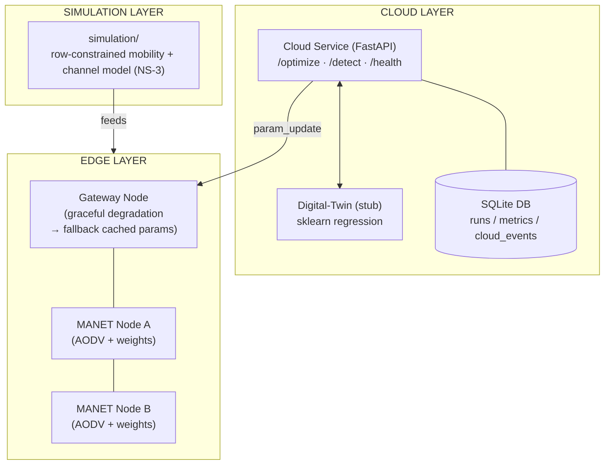

# MANET Nhà Kính — Cloud-Assisted Adaptive Routing (CAAR)

> **NT131 · Nhóm 06** — Kiến trúc định tuyến thích ứng có hỗ trợ điện toán đám mây cho mạng MANET trong nhà kính

[](https://github.com/duckluyencode/manet-greenhouse-cloud-NT131/actions/workflows/cloud-service-ci.yml)
[](https://www.python.org/)
[](https://fastapi.tiangolo.com/)
[](LICENSE)

---

## Tóm tắt

Mạng tùy biến di động (MANET) trong nhà kính phải đối mặt với thách thức độc đáo: khung kim loại gây suy hao tín hiệu, hơi nước ngưng tụ trên lớp phủ nhựa, và các nút di động (robot giám sát) chuyển động theo luống cây cố định. Các giải pháp hiện tại (RPL, LoRaWAN) được thiết kế cho cảm biến tĩnh và không xử lý tốt nút di động.

Đồ án đề xuất kiến trúc **CAAR** — giữ lõi AODV gọn nhẹ tại biên mạng để tiết kiệm năng lượng, đẩy phần tối ưu hóa lên đám mây để có "tầm nhìn toàn cục", và bổ sung cơ chế **graceful degradation** khi mất kết nối cloud.

---

## Kiến trúc hệ thống



---

## Câu hỏi nghiên cứu

| # | Kịch bản | Câu hỏi |
|---|----------|---------|
| S1 | Hiệu năng | CAAR có cải thiện PDR, độ trễ, chi phí điều khiển so với AODV thuần không? |
| S2 | Khả năng hoạt động | Graceful degradation có ngăn hiệu năng giảm dưới ngưỡng no-cloud không? |
| S3 | Chi phí tích hợp | Tại quy mô nào chi phí băng thông vượt quá lợi ích tối ưu hóa? |
| S4 | An ninh | Kênh cloud có tạo bề mặt tấn công mới đáng kể không? |

---

## Cấu trúc dự án

```
manet-greenhouse-cloud/
├── cloud-service/          # Backend FastAPI (Python)
│   ├── app/
│   │   ├── main.py         # Entry point — /health, /optimize, /detect
│   │   ├── db.py           # SQLite layer (runs, metrics, cloud_events)
│   │   ├── models.py       # Pydantic request/response models
│   │   └── twin.py         # Digital-Twin validation (stub → Week 6-7)
│   ├── tests/
│   │   └── test_health.py  # pytest suite
│   └── requirements.txt
├── simulation/             # NS-3 module (Owner: A)
│   └── README.md           # Hướng dẫn cài NS-3 + cấu trúc dự kiến
├── docs/
│   ├── architecture.md     # Kiến trúc chi tiết
│   ├── api-doc.md          # API reference
│   ├── dev-guide.md        # Hướng dẫn developer
│   ├── srs.md              # Software Requirements Specification
│   ├── testing-report.md   # Báo cáo kiểm thử
│   └── user-guide.md       # Hướng dẫn sử dụng
├── CHANGELOG.md
└── README.md
```

---

## Bắt đầu nhanh

### Yêu cầu

- Python 3.11+
- pip

### Cài đặt & chạy cloud-service

```bash
# 1. Cài dependencies
cd cloud-service
pip install -r requirements.txt

# 2. Chạy server
uvicorn app.main:app --reload --port 8000

# 3. Truy cập API docs
# http://localhost:8000/docs
```

### Chạy với Docker

```bash
docker build -t caar-cloud ./cloud-service
docker run -p 8000:8000 caar-cloud
```

### Chạy tests

```bash
cd cloud-service
pytest tests/ -v
```

---

## API nhanh

| Method | Endpoint | Mô tả |
|--------|----------|-------|
| `GET` | `/health` | Kiểm tra service còn sống |
| `POST` | `/optimize` | Nhận telemetry → trả về trọng số định tuyến mới |
| `POST` | `/detect` | Nhận telemetry → cảnh báo bất thường (stub) |

Xem chi tiết tại [`docs/api-doc.md`](docs/api-doc.md).

---

## Tài liệu

| Tài liệu | Mô tả |
|----------|-------|
| [`docs/architecture.md`](docs/architecture.md) | Kiến trúc hệ thống CAAR chi tiết |
| [`docs/api-doc.md`](docs/api-doc.md) | API reference với ví dụ request/response |
| [`docs/dev-guide.md`](docs/dev-guide.md) | Hướng dẫn setup môi trường phát triển |
| [`docs/srs.md`](docs/srs.md) | Đặc tả yêu cầu phần mềm |
| [`docs/testing-report.md`](docs/testing-report.md) | Báo cáo chiến lược và kết quả kiểm thử |
| [`docs/user-guide.md`](docs/user-guide.md) | Hướng dẫn vận hành hệ thống |
| [`simulation/README.md`](simulation/README.md) | Hướng dẫn cài và chạy NS-3 |

---

## Nhóm

| Vai trò | Trách nhiệm |
|---------|-------------|
| **Owner A** — Simulation Lead | NS-3 mobility model, channel model, AODV integration |
| **Owner B** — Cloud/Backend Lead | FastAPI cloud service, Digital-Twin, CI/CD |

---

## License

[MIT](LICENSE)
