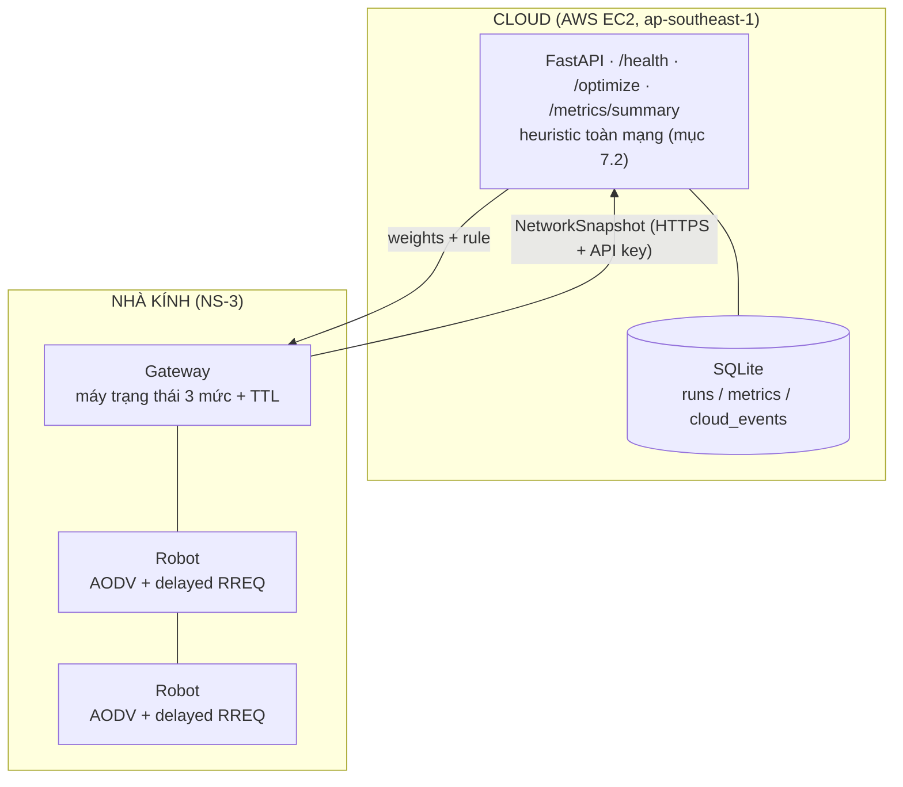

# MANET Nhà Kính — Cloud-Assisted Adaptive Routing (CAAR)

> **NT131 · Nhóm 06** — Định tuyến MANET kết hợp cloud trong hệ thống robot nhà kính

[](https://github.com/duckluyencode/manet-greenhouse-cloud-NT131/actions/workflows/cloud-service-ci.yml)
[](https://www.nsnam.org/)
[](https://www.python.org/)
[](LICENSE)

## Tóm tắt

Robot trong nhà kính di chuyển trên ray giữa các luống cây và gửi dữ liệu về Gateway qua mạng
không dây đa chặng (MANET). CAAR giữ AODV gọn nhẹ trên robot, thêm metric đa tiêu chí (sóng,
pin, số hop) qua cơ chế **delayed RREQ forwarding**, để Gateway hoặc Cloud chọn trọng số cho
metric từ dữ liệu toàn mạng, và tự **hạ cấp an toàn** khi mất Cloud.

Hệ thống được kiểm chứng bằng NS-3 (ns-3.48) trong nhà kính 1 ha, với kênh truyền lấy từ số đo
trong nhà kính cà chua thật (Cama-Pinto et al. 2019) và quỹ đạo robot theo vận hành thực tế
([`docs/greenhouse-survey.md`](docs/greenhouse-survey.md)).

## Kiến trúc



Cloud chỉ quyết định 3 trọng số (w_h, w_r, w_e) cho toàn mạng; logic chọn đường nằm hoàn toàn ở
robot. Mất cloud thì Gateway dùng trọng số cache, quá TTL thì về bộ cân bằng 0,4 / 0,3 / 0,3.

## Kết quả (370 run, mỗi điểm 10 seed)

| Câu | Giả thuyết | Kết quả |
|---|---|---|
| Q1 | Metric đa tiêu chí (`local_optimized`) cho PDR cao hơn AODV gốc (`no_cloud`) | Bác bỏ (p = 0,87) |
| Q2a | Dữ liệu toàn mạng (`gateway_heuristic`) cho PDR cao hơn trọng số cố định | Bác bỏ (p = 0,98) |
| Q2b | Đặt heuristic trên Cloud hay Gateway không khác nhau | Xác nhận (p = 0,99) |
| Q3 | Mất cloud, PDR không thấp hơn `no_cloud` | Xác nhận |

Mạng thưa (6 robot/ha) mất gói chủ yếu vì không có đường về Gateway; mạng dày (16–20 robot/ha)
gần như luôn có đường nhưng mất gói trên link. Kết luận Q1 không đổi khi D_max 5–20 ms.
Chi tiết: [`docs/testing-report.md`](docs/testing-report.md),
bảng và biểu đồ trong [`results/figures/`](results/figures/).

## Cấu trúc repo

```
manet-greenhouse-cloud-NT131/
├── cloud-service/        # FastAPI: main, models, heuristic, security, db + pytest
├── deploy/               # Docker Compose: FastAPI + Caddy (HTTPS Let's Encrypt)
├── simulation/
│   ├── aodv-patch/       # patch AODV: hook delayed RREQ + trace RouteDiscovery
│   ├── scratch/caar.cc   # kịch bản NS-3 cho 4 cấu hình
│   ├── caar-logic/       # caar_logic.h (C++ thuần) + parity test g++
│   ├── vm/               # cài và chạy trên Ubuntu 24.04 (không Docker)
│   ├── install.sh        # áp patch + chép kịch bản vào ns-3-dev
│   └── Dockerfile        # Ubuntu 24.04 + ns-3.48 + CAAR
├── contracts/            # dữ liệu đầu vào: kênh, quỹ đạo, test vector (contracts/README.md)
├── scripts/              # sinh dữ liệu, chạy hàng loạt, kiểm tra NS-3, nhập SQLite, vẽ biểu đồ
├── results/              # raw/ (CSV từng run), figures/ (biểu đồ, hypotheses.md)
└── docs/
```

## Bắt đầu nhanh

### Mô phỏng trên Ubuntu 24.04 (máy ảo hoặc máy thật)

```bash
git clone -b cloud/network-snapshot https://github.com/duckluyencode/manet-greenhouse-cloud-NT131.git
cd manet-greenhouse-cloud-NT131
bash simulation/vm/setup-ubuntu.sh    # ns-3.48 + CAAR vào ~/ns-3-dev, NetAnim vào ~/netanim
bash simulation/vm/demo.sh            # chạy 1 kịch bản và mở NetAnim
```

### Chạy toàn bộ thí nghiệm và vẽ kết quả

```bash
NS3_DIR=~/ns-3-dev scripts/run_batch.sh s1 s2a s2b s3 sens diag
python scripts/import_ns3_results.py --db results/results.db
python scripts/plot_results.py --db results/results.db --out results/figures
```

### Cloud service

```bash
cd cloud-service
pip install -r requirements.txt
export CAAR_API_KEY=dev-key                  # Windows: set CAAR_API_KEY=dev-key
uvicorn app.main:app --reload --port 8000    # Swagger: http://localhost:8000/docs
```

Triển khai trên EC2 có HTTPS: [`docs/user-guide.md`](docs/user-guide.md).

### Kiểm thử

```bash
cd cloud-service && pytest                   # API, heuristic, parity Python
pytest scripts/tests                         # script phân tích
cd simulation/caar-logic && g++ -std=c++17 -O2 -o test_caar_logic test_caar_logic.cpp && ./test_caar_logic
python3 scripts/check_ns3.py --ns3 ~/ns-3-dev --out /tmp/caar-check --seeds 5   # tích hợp NS-3
```

## Tài liệu

| Tài liệu | Nội dung |
|---|---|
| [`docs/architecture.md`](docs/architecture.md) | Kiến trúc, metric, heuristic, hạ cấp, bảo mật, dữ liệu |
| [`docs/greenhouse-survey.md`](docs/greenhouse-survey.md) | Số liệu nhà kính và robot thực tế, môi trường mô phỏng |
| [`docs/testing-report.md`](docs/testing-report.md) | Kiểm thử và kết quả thí nghiệm |
| [`docs/api-doc.md`](docs/api-doc.md) | API cloud service |
| [`docs/user-guide.md`](docs/user-guide.md) | Vận hành: cloud trên EC2, demo bảo mật, mô phỏng, NetAnim |
| [`docs/dev-guide.md`](docs/dev-guide.md) | Môi trường phát triển, script, CI |
| [`docs/srs.md`](docs/srs.md) | Yêu cầu phần mềm |
| [`simulation/README.md`](simulation/README.md) | Cài và chạy NS-3, tham số `caar`, NetAnim |
| [`contracts/README.md`](contracts/README.md) | Định dạng dữ liệu đầu vào và kết quả |

## Nhóm

| Vai trò | Trách nhiệm |
|---|---|
| **Owner A** — Simulation | NS-3: kịch bản `caar`, patch AODV, chạy thí nghiệm |
| **Owner B** — Cloud, logic, phân tích | FastAPI, AWS, bảo mật, `caar_logic.h`, quỹ đạo, kênh, phân tích kết quả |

## License

[MIT](LICENSE)
