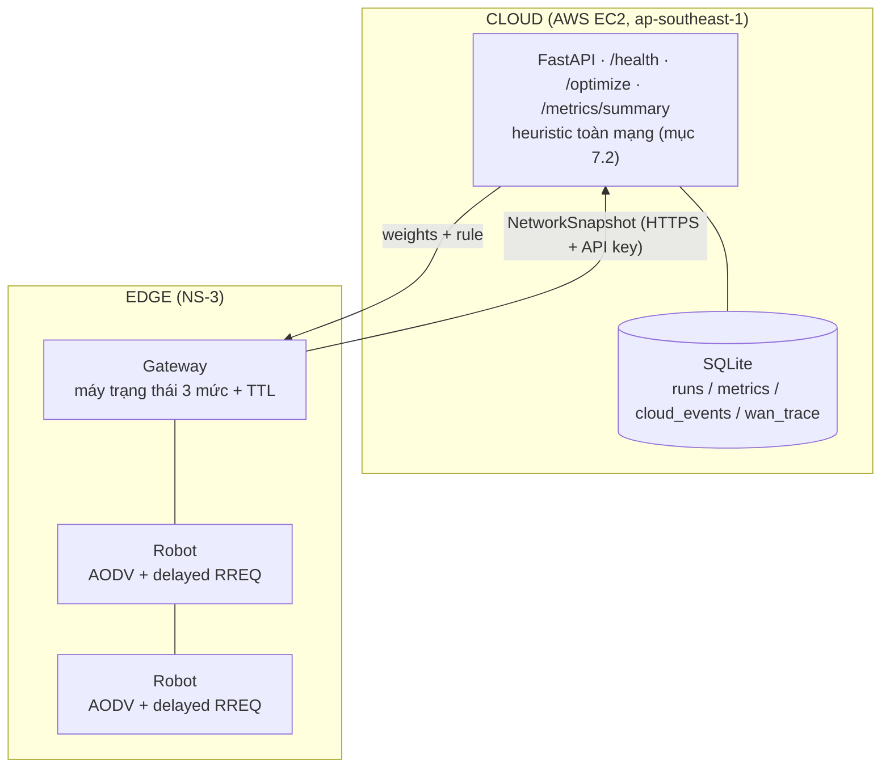

# MANET Nhà Kính — Cloud-Assisted Adaptive Routing (CAAR)

> **NT131 · Nhóm 06** — Kiến trúc định tuyến thích ứng có hỗ trợ điện toán đám mây cho mạng MANET trong nhà kính

[](https://github.com/duckluyencode/manet-greenhouse-cloud-NT131/actions/workflows/cloud-service-ci.yml)
[](https://www.python.org/)
[](https://fastapi.tiangolo.com/)
[](LICENSE)

---

## Tóm tắt

Mạng tùy biến di động (MANET) trong nhà kính phải đối mặt với thách thức độc đáo: khung kim loại gây suy hao tín hiệu, hơi nước ngưng tụ trên lớp phủ nhựa, và các nút di động (robot giám sát) chuyển động theo luống cây cố định. Các giải pháp hiện tại (RPL, LoRaWAN) được thiết kế cho cảm biến tĩnh và không xử lý tốt nút di động.

Đồ án đề xuất kiến trúc **CAAR** — giữ lõi AODV gọn nhẹ tại biên mạng để tiết kiệm năng lượng, đẩy phần tối ưu hóa lên đám mây để có "tầm nhìn toàn cục", và bổ sung cơ chế **graceful degradation** khi mất kết nối cloud.

---

## Kiến trúc hệ thống



Cloud chỉ quyết định 3 trọng số (w_h, w_r, w_e); mất cloud thì Gateway hạ cấp
về trọng số cache rồi bộ cân bằng, robot vẫn định tuyến được.

---

## Câu hỏi nghiên cứu

| # | Giả thuyết | Kịch bản |
|---|---|---|
| Q1 | `local_optimized` cho PDR cao hơn `no_cloud` | S1 |
| Q2a | `gateway_heuristic` cho PDR cao hơn `local_optimized` | S1 |
| Q2b | `cloud_assisted` và `gateway_heuristic` không khác nhau có ý nghĩa | S1, S2 |
| Q3 | Khi mất cloud, PDR không thấp hơn `no_cloud` | S2 |

---

## Cấu trúc dự án

```
manet-greenhouse-cloud-NT131/
├── contracts/              # hợp đồng dữ liệu A ↔ B (xem contracts/README.md)
│   ├── parity_cases.json   # test vector heuristic + chi phí c_i + máy trạng thái Gateway
│   ├── channel.json        # n, σ, L0, tầm sóng
│   └── waypoints/          # quỹ đạo robot theo số robot và seed
├── cloud-service/          # Owner B — FastAPI
│   └── app/                # main, models, heuristic, security, db
├── deploy/                 # Owner B — docker-compose (FastAPI + Caddy HTTPS)
├── scripts/                # Owner B — sinh dữ liệu, đo WAN, chạy hàng loạt, nhập SQLite, vẽ
├── simulation/
│   ├── caar-logic/         # Owner B — caar_logic.h (C++ thuần) + parity test g++
│   ├── scratch/            # Owner A — kịch bản NS-3
│   └── aodv-patch/         # Owner A — delayed RREQ trong RecvRequest
├── results/                # raw/ (CSV NS-3), figures/ (biểu đồ)
└── docs/
```

---

## Bắt đầu nhanh

### Yêu cầu

- Python 3.11+
- pip

### Cloud service

```bash
cd cloud-service
pip install -r requirements.txt
export CAAR_API_KEY=dev-key          # Windows: set CAAR_API_KEY=dev-key
uvicorn app.main:app --reload --port 8000   # Swagger: http://localhost:8000/docs
pytest
```

### Deploy (EC2)

```bash
cp deploy/.env.example deploy/.env   # điền CAAR_API_KEY, CAAR_DOMAIN
docker compose -f deploy/docker-compose.yml --env-file deploy/.env up -d --build
```

### Logic C++ và script

```bash
pip install -r scripts/requirements.txt
python scripts/gen_parity_cases.py && (cd simulation/caar-logic &&   g++ -std=c++17 -O2 -o test_caar_logic test_caar_logic.cpp && ./test_caar_logic)
python scripts/gen_waypoints.py
python scripts/fit_channel.py --tx-power 16 --rx-sensitivity -82
python scripts/wan_probe.py --url https://<tên-miền>/optimize --interval 2 --hours 24 --out contracts/wan_trace.csv
NS3_DIR=~/ns-3-dev scripts/run_batch.sh s1 s2a s2b
python scripts/import_ns3_results.py --db results/results.db
python scripts/plot_results.py --db results/results.db
pytest scripts/tests
```

---

## API nhanh

| Method | Endpoint | Mô tả |
|--------|----------|-------|
| `GET` | `/health` | Kiểm tra service còn sống |
| `POST` | `/optimize` | `NetworkSnapshot` → trọng số + luật (cần `X-API-Key`) |
| `GET` | `/metrics/summary` | PDR, độ trễ trung bình theo cấu hình và kịch bản (cần `X-API-Key`) |

Xem chi tiết tại [`docs/api-doc.md`](docs/api-doc.md).

---

## Tài liệu

| Tài liệu | Mô tả |
|----------|-------|
| [`docs/architecture.md`](docs/architecture.md) | Kiến trúc hệ thống CAAR chi tiết |
| [`docs/api-doc.md`](docs/api-doc.md) | API reference với ví dụ request/response |
| [`docs/dev-guide.md`](docs/dev-guide.md) | Hướng dẫn setup môi trường phát triển |
| [`docs/srs.md`](docs/srs.md) | Đặc tả yêu cầu phần mềm |
| [`docs/testing-report.md`](docs/testing-report.md) | Báo cáo chiến lược và kết quả kiểm thử |
| [`docs/user-guide.md`](docs/user-guide.md) | Hướng dẫn vận hành hệ thống |
| [`simulation/README.md`](simulation/README.md) | Hướng dẫn cài và chạy NS-3 |

---

## Nhóm

| Vai trò | Trách nhiệm |
|---------|-------------|
| **Owner A** — Simulation | Chỉ việc cần NS-3: `scratch/caar.cc`, sửa `RecvRequest`, chạy kịch bản |
| **Owner B** — Cloud, logic, phân tích | FastAPI, AWS, bảo mật, trace WAN, `caar_logic.h`, quỹ đạo, kênh, nhập SQLite, biểu đồ |

---

## License

[MIT](LICENSE)
